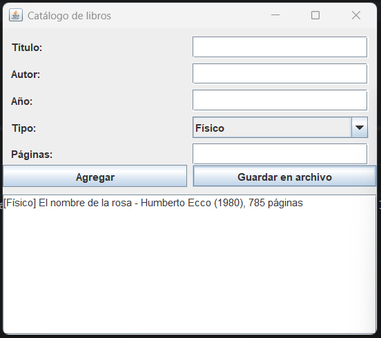

# Catálogo de libros

**Autor:** Nicolas Santa
**Curso:** Programación Orientada a Objetos II (POO2) - Laboratorio 1

## Descripción

Aplicación de escritorio en Java con Swing que registra libros físicos y digitales en un catálogo que vive en memoria. Valida los datos ingresados y muestra mensajes claros en español cuando algo está mal. Además permite guardar el catálogo en un archivo de texto con el botón **Guardar en archivo**.



## Estructura del proyecto

```
src/
├── Main.java                      Punto de entrada
├── dominio/                       Reglas de negocio (sin Swing)
│   ├── Libro.java                 Clase abstracta con título, autor y año privados
│   ├── LibroFisico.java           Agrega número de páginas
│   ├── LibroDigital.java          Agrega tamaño en megas
│   ├── DatoInvalidoException.java Excepción propia del negocio
│   └── Catalogo.java              Lista de libros; agregar, listar y buscar (sobrecargado)
└── ui/
    └── VentanaCatalogo.java       Interfaz gráfica (sin reglas de negocio)
```

La clase `Catalogo` no importa nada de Swing y `VentanaCatalogo` no contiene reglas de negocio, de modo que la interfaz se puede reemplazar sin modificar el dominio.

## Validaciones

- El título y el autor no pueden estar vacíos ni contener solo espacios.
- El año debe ser un número entre 1450 y el año actual.
- Si el año no es numérico, se atrapa `NumberFormatException` y se muestra un mensaje amable.
- Si el año está fuera de rango, el dominio lanza `DatoInvalidoException`.

## Guardar en archivo

El botón **Guardar en archivo** abre un selector de ubicación y escribe una línea por libro en un archivo de texto (UTF-8). La escritura está en `Catalogo.guardarEnArchivo`, que usa `try-with-resources` para cerrar el archivo aunque ocurra un error. Si el catálogo está vacío o el disco falla, la ventana muestra un mensaje claro en español.

## Cómo ejecutarlo

1. Instalar el JDK (versión 17 o superior).
2. Clonar el repositorio:
   ```
   git clone https://github.com/NicSanDevProyect/poo2-lab1-santa.git
   ```
3. Abrir la carpeta en IntelliJ IDEA, abrir `src/Main.java` y presionar **Run**.

También se puede compilar desde la consola, dentro de la carpeta del proyecto:

```
javac -encoding UTF-8 -d out src/Main.java src/dominio/*.java src/ui/*.java
java -cp out Main
```
